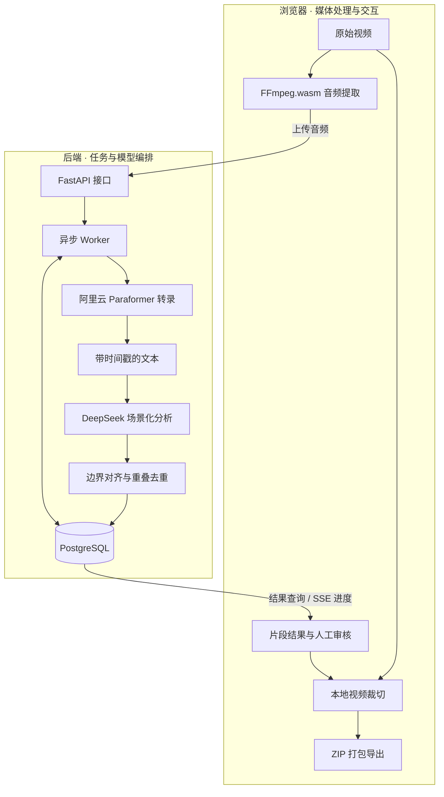

# AI Slice｜AI 视频内容生产与工作流编排

> 从长视频理解到片段生成，构建可追踪、可评估、可迭代的 AI 视频处理链路。

AI Slice 是一个面向直播回放、访谈和课程内容的 AI 视频产品，目前已完成可运行 Demo。项目将语音识别、大语言模型、浏览器媒体处理与异步任务编排整合为一条工作流，覆盖音频提取、语音转录、内容分析、片段推荐及本地切片导出。

当前研发重点是在现有 Demo 上持续研究和整合模型、Agent 与自动化工具，提升流程稳定性和内容质量，减少人工重复操作，逐步形成具备明确能力边界与交付标准的视频产品。

## 01 · 产品定位

长视频再加工的主要成本不仅在剪辑本身，还在于理解内容、识别有效片段、定位时间边界，以及将分析结果转换为可执行的制作方案。

AI Slice 将这一过程拆解为三个相互衔接的层次：

- **内容感知**：将音频转化为带时间戳的文本，为后续理解提供可定位的依据。
- **语义决策**：结合场景策略生成候选片段、标题、摘要和剪辑建议。
- **工具执行**：根据结构化片段计划调用媒体工具，完成裁切与文件导出。

系统保留人工审核与最终选择环节，目标是降低素材筛选、时间点整理和批量导出的操作成本，让创作者将精力集中在内容判断与表达上。

## 02 · 系统架构

采用“浏览器媒体处理 + 服务端模型编排”的职责划分：浏览器承担原始视频处理，后端负责音频接收、外部模型调用、任务调度和结果持久化。



### 技术分层

| 层次 | 实现技术 | 主要职责 |
| --- | --- | --- |
| 交互层 | React、TypeScript、Tailwind CSS | 素材导入、场景选择、任务进度、片段审核 |
| 媒体执行层 | FFmpeg.wasm、Web Worker、WORKERFS | 音频提取、本地视频访问、片段裁切与资源释放 |
| 接口层 | FastAPI、Pydantic | 请求建模、输入校验、任务与结果接口 |
| 编排层 | Python asyncio、数据库任务轮询 | 模型调用、并发执行、状态流转与错误处理 |
| 模型层 | 阿里云 Paraformer、DeepSeek | 时间戳转录、语义分析、标题与剪辑建议 |
| 持久化层 | PostgreSQL、SQLAlchemy、Alembic | 任务状态、转录结果、片段元数据与结构迁移 |
| 工程工具 | Vite、uv、单元测试、TypeScript 构建检查 | 依赖管理、开发构建与回归验证 |

## 03 · 核心技术设计

### 3.1 浏览器侧媒体处理与资源管理

浏览器先将视频转换为 16 kHz 单声道 MP3，再上传音频供后端识别。最终导出时，前端使用原始视频和后端生成的片段计划进行本地裁切。

这一设计减少完整视频上传和服务端视频处理的需求。音频仍会发送至后端与云端识别服务，不能将其理解为全流程离线处理。

针对较大文件，媒体运行时使用 WORKERFS 挂载浏览器 File，避免在输入阶段主动将整份视频读入 JavaScript 字节数组。运行时管理还包括实例复用、取消信号、Worker 终止以及挂载文件与临时产物的清理。

这些机制有助于控制资源生命周期，但大文件处理仍受浏览器内存、编码格式与设备性能影响，需要通过实测确定支持范围。

### 3.2 流式语音识别与时间戳归一化

后端通过 WebSocket 接入阿里云 Paraformer，按照“启动任务 → 分帧发送音频 → 接收识别事件 → 结束任务”的协议完成转录。

接入层负责：

- 并行发送音频与接收识别结果，避免将完整音频一次性加载到内存。
- 过滤中间识别结果和心跳事件，仅保留最终句子。
- 将服务端毫秒时间戳转换为系统统一的秒级时间表示。
- 在句级结束时间缺失时，尝试使用词级结束时间补全；无法取得有效边界时明确报错。
- 将鉴权失败、超时和服务端任务失败转换为可识别的业务错误。

转录结果以结构化片段表达，作为内容分析与时间边界校验的共同依据：

```text
TranscriptSegment = {
    start: 秒级开始时间,
    end: 秒级结束时间,
    text: 识别文本
}
```

### 3.3 场景化长文本分析

内容分析围绕直播、访谈和课程配置不同策略，调整提示词、片段时长要求与重叠判定阈值。

| 场景 | 主要分析目标 |
| --- | --- |
| 直播回放 | 识别高信息量、互动性和传播潜力较强的片段 |
| 访谈内容 | 保留相对完整的问答回合，减少上下文缺失 |
| 课程讲解 | 围绕知识点组织片段，关注讲解连续性 |

长转录按估算的文本 token 预算分批分析，当前批次上限为 6000。这里使用的是长度估算，并非模型 tokenizer 的精确计数。

单批次调用设置超时，并对异常、空响应或无法解析出片段的结果进行有限次数重试。当前批次按顺序执行，后续可在服务限流和成本约束下评估并发调度。

### 3.4 从模型输出到可执行片段计划

模型输出并不直接等于最终剪辑结果。分析服务会对候选结果进行解析、时间边界对齐、排序和去重，将其整理为供前端执行的片段计划。

```text
转录文本分批
    → 场景化提示词
    → LLM 候选片段
    → 结构化解析
    → 转录边界对齐
    → 按评分排序
    → 重叠片段去重
    → Clip Plan 持久化
```

片段计划包含时间范围、标题、摘要、类型、推荐文案和模型评分。评分用于候选排序，不代表经过验证的传播效果预测。

通过将语义决策与媒体执行分离，可以独立改进内容分析策略和导出实现，也为后续模型对比、人工反馈和结果评估保留统一的数据结构。

### 3.5 数据库驱动的异步任务编排

后端将任务状态持久化到 PostgreSQL，由进程内异步 Worker 轮询领取待处理任务。多个 Worker 共享 asyncio.Lock，串行执行任务领取步骤，避免同一进程内重复领取。

处理过程中持续记录阶段、进度和错误信息。进程启动时，会将中断的进行中任务重新置为待处理状态；用户也可以对失败任务发起重试。

当前机制的边界是：

- 领取互斥限定于单进程，不提供跨进程任务租约。
- 中断恢复通过重新排队执行，不等同于阶段级断点续跑。
- 重试可能重复调用外部模型，尚不能保证恰好一次执行。
- 数据库轮询适合当前 Demo，规模扩大后需要重新评估调度与背压机制。

### 3.6 进度同步与交互容错

前端通过 SSE 订阅任务进度，连接异常时回退到轮询查询，使任务结果能够在连接恢复后重新获取。

本地导出通过 AbortController 传递取消信号，并在取消或页面卸载时终止相关处理、释放媒体资源。云端分析进度与浏览器导出进度分别管理，避免将“片段计划生成完成”误认为“视频文件已经导出”。

## 04 · 模型、Agent 与自动化的演进

当前系统使用明确步骤的工作流编排，已经连接语音识别、内容分析和媒体工具，但尚未实现自主规划的多 Agent 系统。

后续 Agent 能力将围绕可验证的具体任务引入，而不是仅增加调用层级：

| 研究方向 | 拟承担职责 | 验证重点 |
| --- | --- | --- |
| 质量检查 Agent | 检查片段语义完整性、时间边界及文案与原文的一致性 | 问题检出率、误报率、额外延迟 |
| 失败诊断 Agent | 结合错误信息区分网络、鉴权、模型输出和素材问题 | 诊断准确性、人工排查时间 |
| 策略选择 Agent | 根据内容类型和处理约束选择分析策略或模型 | 结果质量、成本与执行稳定性 |
| 工具执行编排 | 在受约束的工具接口内执行处理步骤并检查产物 | 工具调用成功率、状态一致性 |

引入这些能力时，需要同步设计输入输出契约、工具权限、执行预算、终止条件和人工确认节点。其有效性应通过相同素材上的对照评估验证。

## 05 · 质量与稳定性建设方向

以下是拟建立的评估体系，当前未宣称已有完整基准数据或生产 SLA。

| 维度 | 拟评估指标 | 对应问题 |
| --- | --- | --- |
| 转录质量 | 字错误率、句子边界偏差、专有名词识别表现 | 文本是否准确，时间点能否用于剪辑 |
| 片段质量 | 语义完整性、切点准确性、重复率、人工采纳率 | 推荐结果是否具有实际使用价值 |
| 生成质量 | 标题相关性、摘要忠实度、剪辑建议可执行性 | 文案是否符合素材，建议能否落地 |
| 流程稳定性 | 任务成功率、阶段失败率、重试恢复率 | 处理过程能否稳定完成 |
| 性能与成本 | 阶段耗时、P95 延迟、单位视频处理成本 | 体验和资源消耗是否可接受 |
| 自动化程度 | 人工操作次数、审核耗时、返工比例 | 是否减少了真实工作量 |

工程迭代将优先完善结构化日志、错误分类、模型调用观测、可复用评估样本，以及模型或提示词变更后的回归检查。对于部分分析批次失败的情况，还需进一步明确结果完整性标记和补偿策略。

## 06 · 从 Demo 到可交付产品

当前 Demo 已具备视频预处理、阿里云转录、DeepSeek 内容分析、任务管理及浏览器切片导出能力。后续产品化围绕以下方面推进：

1. **处理可靠性**：完善阶段级检查点、幂等控制、限流重试、超时预算与故障恢复。
2. **模型可替换性**：规范服务适配层和能力描述，支持对不同模型进行质量、延迟与成本比较。
3. **内容闭环**：将人工审核结果用于评估与策略迭代，形成可复现的改进依据。
4. **规模化执行**：按实际负载评估独立任务队列、分布式 Worker、并发配额和资源调度。
5. **交付基础设施**：补齐身份认证、数据隔离、存储生命周期、部署运维与成本管理。

项目持续围绕三个目标迭代：让处理链路更可靠，让输出内容更可用，让用户完成同一项视频任务所需的人工操作更少。
