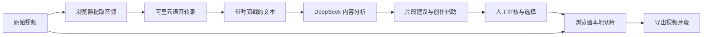

# AI Slice｜AI 视频内容生产工作流

AI Slice 是一个面向长视频内容再加工的 AI 视频产品，目前已完成可运行 Demo，打通了视频导入、语音转录、内容理解、精彩片段推荐与本地切片导出的核心流程。

我们目前重点推进的是技术研究与工程整合：围绕实际视频生产场景，研究不同模型、Agent 与自动化工具如何协同工作，让已有流程运行得更稳定、产出质量更好、人工参与更少，并逐步形成可以对外交付的产品。

## 产品要解决的问题

直播回放、访谈和课程视频中往往包含大量可复用内容，但从长视频到可发布片段，需要反复观看、筛选信息、定位时间点、整理标题和执行剪辑。流程依赖人工经验，处理效率和产出质量也难以保持一致。

AI Slice 将这些步骤组织成可追踪的处理流程：模型负责语音识别、内容理解与片段建议，工具负责媒体处理和文件导出，使用者负责审核、选择与最终确认。目标是减少重复操作，让人工精力更多投入内容判断与创意表达。

## 当前 Demo 能力

| 环节 | 已实现能力 |
| --- | --- |
| 视频预处理 | 在浏览器内提取音频，减少完整视频上传带来的时间与带宽开销 |
| 语音转录 | 接入阿里云百炼 Paraformer，生成带句级时间戳的转录文本 |
| 内容分析 | 使用 DeepSeek 分析文本，输出片段时间范围、标题、摘要与推荐文案 |
| 场景适配 | 提供直播、访谈与课程场景的分析策略，调整片段选择和时长要求 |
| 创作辅助 | 按需生成标题候选和剪辑思路，辅助人工审核与后续制作 |
| 任务管理 | 展示处理进度与历史记录，支持失败任务重试 |
| 切片导出 | 根据推荐时间段，在浏览器端处理原视频并打包下载 |

当前验证覆盖了从视频输入到片段推荐的处理链路；产品仍处于 Demo 迭代阶段。长期稳定性、规模化处理能力和交付效果需要通过更广泛的素材与使用场景持续验证。

## 技术流程

### 模型与工具协同

语音识别模型负责将音频转为可定位的文本，大语言模型负责理解内容、组织片段和生成文案，FFmpeg.wasm 负责实际媒体处理。后端通过结构化输入、任务状态和服务调用，将不同能力连接起来。

当前实现采用明确步骤的工作流编排，尚未实现自主规划的多 Agent 系统。后续 Agent 研究将围绕已有流程中的具体问题展开，例如质量检查、失败诊断和处理策略选择，并通过评估确认其收益。

### 长视频内容分析

转录文本按长度拆分为多个分析批次，以控制单次模型请求的上下文规模。模型结果转换为统一的片段结构，再进行合并与重叠去重，供前端展示和切片使用。

针对不同内容类型，分析策略分别关注直播中的高信息量片段、访谈中的问答完整性，以及课程中的知识点连续性。时间戳贯穿转录、推荐和导出环节，使模型建议能够对应到原始素材。

### 异步任务与状态管理

后端使用 FastAPI 提供接口，通过数据库记录任务状态与处理结果，使用进程内异步 Worker 执行转录和分析。前端结合进度订阅与轮询展示任务变化，用户可以查看失败信息并发起重试。

当前并发控制以单进程运行为基础。分布式任务调度、跨进程一致性和更完善的故障恢复属于后续工程化方向。

### 浏览器端媒体处理

视频音频提取和最终切片通过 FFmpeg.wasm 在浏览器中完成，后端主要承担音频接收、模型调用、任务编排与结果存储。原始视频无需完整上传即可完成主要流程。

这种分工减少了服务器侧的视频处理负担，同时也要求关注浏览器兼容性、大文件处理、内存占用和导出体验。

## 技术栈

| 层次 | 技术 |
| --- | --- |
| 前端交互 | React、TypeScript、Vite、Tailwind CSS |
| 浏览器媒体处理 | FFmpeg.wasm、Web Worker |
| 后端服务 | Python、FastAPI、异步 I/O |
| 数据持久化 | PostgreSQL、SQLAlchemy、Alembic |
| 语音识别 | 阿里云百炼 Paraformer、WebSocket 音频流 |
| 内容理解与生成 | DeepSeek、场景化提示词、结构化结果解析 |
| 流程编排 | 数据库任务状态、异步 Worker、进度订阅与轮询 |

## 持续研究与产品化方向

以下是后续重点，不代表当前版本均已实现。

- **模型选择与评估**：对比不同转录和内容理解方案，结合识别质量、片段可用性、延迟与调用成本选择合适组合。
- **流程稳定性**：完善超时控制、重试策略、错误分类、可观测性与故障恢复，减少任务中断后的人工排查。
- **内容质量**：建立覆盖语义完整性、切点准确性、重复片段和文案相关性的评估方法，用真实素材验证改进效果。
- **Agent 与自动化整合**：探索质量检查、异常诊断和工具调用能力，把必要的人工确认保留在关键节点。
- **减少人工操作**：优化素材导入、任务处理、结果审核和批量导出之间的衔接，减少重复选择和手动整理。
- **可交付能力**：逐步补齐身份认证、数据隔离、部署运维、成本管理和交付文档，使 Demo 向可持续使用的产品演进。

项目的核心工作，是将模型能力转化为可验证、可维护的视频生产流程，并用实际任务的成功率、内容可用性和人工操作量衡量迭代效果。
